<p align="center">
  
</p>

<p align="center">
  
</p>

<p align="center">
  <a href="https://mrithika-portfolio.vercel.app/"></a>
  <a href="https://linkedin.com/in/mrithika-kumar-a12865316"></a>
  <a href="mailto:mrithikakumar1112@gmail.com"></a>
  <a href="https://discord.com/users/1287637268168704080"></a>
  <a href="https://hackerrank.com/profile/mrithikakumar111"></a>
  
</p>

<br/>

<p align="center"></p>

<table align="center">
  <tr>
    <td align="right"><code>languages/</code></td>
    <td></td>
  </tr>
  <tr>
    <td align="right"><code>frontend/</code></td>
    <td></td>
  </tr>
  <tr>
    <td align="right"><code>backend/</code></td>
    <td></td>
  </tr>
  <tr>
    <td align="right"><code>ai-ml/</code></td>
    <td></td>
  </tr>
  <tr>
    <td align="right"><code>databases/</code></td>
    <td></td>
  </tr>
  <tr>
    <td align="right"><code>cloud-devops/</code></td>
    <td></td>
  </tr>
</table>

<p align="center">
  
  
  
  
  
  
  
  
  
</p>

<br/>

<p align="center"></p>

```diff
@@ IT Department Intern — Integral Coach Factory (ICF) / Indian Railways · Jun 2026 @@
```
- Migrated 6 legacy PHP/Oracle financial reporting systems to Python (WMS Outturn, Loan Transaction variants, Bills Summary, IPAS Oracle load reporting), integrating Oracle and MySQL databases. Reduced manual reporting effort by approximately 35%, streamlined reporting workflows, and authored comprehensive technical documentation to support future system modernization.
- Designed and built a production-ready GST billing platform using React, Node.js/Express, and Oracle XE, following full SDLC practices — implemented role-based authentication and automated PDF generation, cutting invoice processing time by approximately 60%.

```diff
@@ Deep Learning & ML Research Intern — AI Quantum Smart Solutions Pvt. Ltd. · May 2026 – Jul 2026 @@
```
- Developed LSTM, Bi-LSTM, and GRU sentiment analysis models on the GOP Debate Twitter dataset, achieving 85% accuracy through data structure–driven preprocessing and hyperparameter tuning, under a director from NIT Surathkal.
- Completed 1D CNN regression and MLP classification assignments; prepared technical notes spanning OpenCV, Pandas, Scikit-learn, and ANN concepts.

```diff
@@ Remote Sensing & GIS Intern — India Space Academy · Jan 2026 @@
```
- Built an AI-based vegetation health assessment system using NDVI, processing large-scale geospatial datasets in Python over a 4-week intensive program to extract environmental insights from satellite imagery.

<br/>

<p align="center"></p>

#### `🤖 ai-ml & computer-vision/`

| | Project | What it does | Stack |
|:-:|---|---|---|
| 🚦 | [**Traffic Violation Detection**](https://github.com/Mrithikahub/traffic-violation-detection) | AI-based intelligent vehicle monitoring — detects & tracks vehicles, reads number plates, estimates speed and flags overspeeding, wrong-side, lane-change & tailgating violations | `YOLOv8` `ByteTrack` `EasyOCR` `OpenCV` `Streamlit` |
| ☀️ | **Solar Panel Site Suitability** | Predicts the best locations for solar panels worldwide from remote-sensing data, with an interactive website (Tamil Nadu case study) | `Python` `ML` `Remote Sensing` `Web` |
| 💬 | **Twitter Sentiment Analysis** | LSTM vs Bi-LSTM vs GRU comparison on the GOP Debate dataset (~85% accuracy) | `TensorFlow` `Keras` `NLP` |
| 🌿 | **NDVI Vegetation Health** | Vegetation health assessment from satellite imagery | `Python` `GIS` `NDVI` |
| ♻️ | **EcoSort** | AI waste classification platform | `React` `Spring Boot` `Docker` |
| 💧 | **Hidden Aquifer Mapper** | ML groundwater level prediction & depletion-risk mapping | `Python` `XGBoost` |

#### `🧠 genai & agents/`

| | Project | What it does | Stack |
|:-:|---|---|---|
| 🏙️ | [**VelocityCivic**](https://github.com/Mrithikahub/velocitycivic) | Decision intelligence platform on Chicago crime data | `BigQuery` `LLaMA 3.1` `RAPIDS` `Streamlit` |
| 📋 | **AI Compliance Reviewer** | Local agent that retrieves only the needed review "skills" and generates explainable compliance reports for submissions | `Ollama` `Qwen` `FastAPI` `LangChain` |
| 🎫 | **RAG Support Triage Agent** | Terminal agent that triages support tickets and escalates sensitive ones | `RAG` `TF-IDF` `Mistral` |
| 💊 | **EvoDoc** | Drug safety engine powered by a medical LLM | `FastAPI` `Meditron` `Ollama` |
| 📄 | **SAR Automation** | AI report generator for structured analytical reports | `Python` `NLP` `RAG` |
| 🕸️ | **Resume & Employee Knowledge Graphs** | Resume/employee data turned into a Neo4j knowledge graph + vector DB, linked via NER | `Neo4j` `Chroma` `MySQL` `Ollama` |

#### `🌐 full-stack & apps/`

| | Project | What it does | Stack |
|:-:|---|---|---|
| 🧾 | **LAWN GST Billing System** | Production GST billing platform with role-based auth & automated PDFs (built at ICF) | `React` `Express` `Oracle XE` |
| 🛡️ | **TriggerPe** | Parametric income insurance for gig workers | `FastAPI` `Next.js` `scikit-learn` |
| 💰 | **SpendChakra** | Expense, expiry, warranty & budget tracker for Indian families | `React Native` `Expo` |
| 🎯 | **AtomQuest** | Goal setting & tracking portal | `React` `Node.js` `Turso` |

<br/>

<p align="center"></p>

<p align="center">
  
  
</p>

<p align="center">
  
</p>

<p align="center">
  <picture>
    <source media="(prefers-color-scheme: dark)" srcset="https://raw.githubusercontent.com/Mrithikahub/Mrithikahub/output/car-dark.svg" />
    
  </picture>
</p>

<p align="center"><code>mrithika@github ~ % echo "thanks for visiting — let's build something ✨"</code></p>
